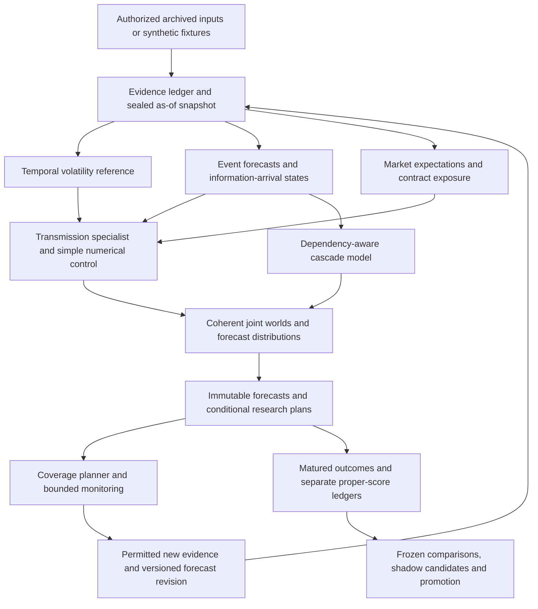

# VOLTERRA: gap analysis for `voltupd.md`

**Audit date:** October 18, 2026. **Scope:** this directory only. **Deliverable:** implementation gap analysis and proposed acceptance plan; no application implementation or scope approval is implied.

**Subsequent assessment:** [GOAL_V2_ASSESSMENT.md](GOAL_V2_ASSESSMENT.md) compares this report with the later-supplied `GOALn.md` and `VOLTERRA GOAL v2.txt`, and qualifies the inventory now that a donor checkout is present. The findings and test counts below record the original audit; its T/VU/NG roadmap is not a substitute for reconciling the candidate v2 VT roadmap.

## 1. Finding and intended product

`voltupd.md` describes two connected extensions:

1. **Event Forecast and Transmission Engine:** forecast external events and information arrivals, distinguish those forecasts from market expectations, and estimate instrument-specific volatility responses.
2. **Cascade Engine and Scenario Coverage Planner:** model dependent precursors, shared drivers and shared outcomes; prepare conditional research plans; select useful monitoring under a fixed budget.

The intended operator is a researcher deciding which developing events to monitor and how they change an inspectable volatility forecast. The useful output is a calibrated downstream distribution with an actionable research window, its supporting evidence, and its past forecasting record. A plausible event narrative, a high conditional probability, or a simulated coverage percentage does not establish that value.

**The current directory is a design package, not a partly operating version of that product.** The only application-adjacent executable is `tools/validate_specs.py`. There is no `src/`, application test suite, persistent database, model worker, CLI, API, UI, trained event model, cascade inference engine, or coverage optimizer. The four JSON schemas and hand-authored examples are useful starting material.

Consequently, making the update real requires both the original VOLTERRA foundation and new event/cascade capabilities. Adding news features or a graph visualization would leave the principal gaps unresolved.

**Operational alignment:** none of the 24 grouped capabilities in section 4 is fully implemented. This is an implementation inventory, not a percentage estimate of engineering effort. Existing prose alignment and package validation receive separate credit below.

## 2. Evidence and executed verification

Read all 660 lines of `voltupd.md`, `AGENTS.md`, `GOAL.md`, `DESIGN_SPEC.md`, `DATA_CONTRACTS.md`, `SCIENCE_AND_EVALUATION.md`, `BUILD_PLAN.md`, `ACCEPTANCE_TESTS.md`, `REUSE_AUDIT.md`, the source register, all schemas/configuration/examples, and the validator. `STANDARDS.md`, `IMPLEMENT.md`, `DECISIONS.md`, `PROGRESS.md`, and `TASK_QUEUE.md` were absent at the beginning of the audit.

| Observation | Evidence | Implication |
|---|---|---|
| No Git repository in this directory or its discovered parents | `git status --short --branch` returned “not a git repository” | No commit baseline or historical implementation could be audited here. Initialize version control as implementation work; do not infer another checkout. |
| Only one Python implementation file | File inventory; `tools/validate_specs.py` | No runtime services or model code are hidden behind the proposed layout in `BUILD_PLAN.md:5–25`. |
| Four schemas; four positive examples; two invalid example files | `schemas/`, `examples/` | Fixtures describe records; they do not create forecasts or reconstruct history. |
| All six candidate registry entries disabled and unpinned | `config/model_registry.json` | Model availability, licenses, artifacts and compatibility remain to be verified. |
| No tested application dependency lock | `requirements-spec-validation.txt:1` contains `jsonschema>=4.18,<5` | This is a validator requirement range, not a reproducible forecasting environment. |
| Original package integrity intact | All 26 entries in `MANIFEST.json` matched their hashes | `voltupd.md` is an addition outside that original manifest. Preserve the v1 manifest and issue a new version when integrating it. |

The validator was executed using **Python 3.12.15, jsonschema 4.25.1, arm64** in an isolated environment against temporary copies of `schemas/`, `config/`, and `examples/`. Its `ROOT` was redirected to that temporary copy so the original `PACKAGE_VALIDATION.json` was preserved. Installed dependency versions and input hashes are recorded in [the verification receipt](reports/voltupd-gap-analysis/verification.json).

**Actual result: 28/28 package-only checks passed; 0/78 planned application acceptance requirements executed.** This reproduces package validation only. No posterior inference, weather ingestion, forecasting, replay, latency benchmark, market-data study, or economic evaluation ran.

Eight additional focused probes produced six acceptances and two rejections. Acceptances below expose limitations or defects; they are not successful application tests.

## 3. Existing material worth retaining, and defects to close

### Reusable specification scaffolding

| Existing element | What actually works | What is still required |
|---|---|---|
| `evidence_check`, validator lines 44–54 | Checks per-record historical availability, publication ordering and live receipt; distinguishes certified late imports | A permission-aware, append-only ledger that selects the correct revision and seals real origin snapshots |
| `forecast_check`, lines 56–94 | Checks monotone quantiles, variance/volatility conversion, producer identity and declared capability consistency | Actual distributions, artifact loading, calibration, target/calendar validation, lineage and cross-record integrity |
| `graph_check`, lines 96–144 | Checks declared nodes/edges, instantaneous cycles and a small distribution subset | Trusted graph compilation, per-family validation, numerical inference, time unrolling and event/cascade semantics |
| `decision_check`, lines 146–150 | Checks action membership, estimated cost versus a supplied budget and a supplied approval boolean | An authoritative policy service, transactional reservations, dispatcher, retries and completion accounting |
| Synthetic examples | Clearly identify their hand-authored origin and preserve explicit missing capability messages | Seeded data-generating worlds, known-answer inference, leakage regressions and complete replay runs |
| Original architecture/science plan | Already specifies as-of access, distributional forecasting, ESS controls and delayed learning | Implemented code and the additional event/cascade contracts below |

Do not copy aXc-ACE wholesale. `REUSE_AUDIT.md` is a prior source-audit document, not reusable code present in this directory. Any extraction still needs direct code review, pinned attribution, license notices and new origin-alignment tests. No source-repository execution occurred during this audit.

### Verified limitations and defects

| ID / priority | Probe and current behavior | Required correction or completion |
|---|---|---|
| F01 / P0 | `Student-t(df=3, loc=0, scale=-1)` is accepted by `graph_check`; line 139 checks only degrees of freedom | Validate required/extraneous parameters, positive scale, finite numeric values and compatible support for every admitted family. Keep unsupported families explicitly rejected. |
| F02 / P0 | JSON `1e999` becomes positive infinity and is accepted as an observed evidence value | `parse_constant` blocks literal NaN/Infinity but does not catch exponent overflow. Validate finiteness after parsing, including nested parameters, paths, observations and summaries. |
| F03 / P0 runtime gap | A forecast can reference nonexistent snapshot/model/calibration IDs and still pass | Add transactional foreign keys and content-addressed artifact verification before accepting a runtime forecast. Schema validation cannot provide referential integrity. |
| F04 / P0 runtime gap | A synthetic forecast can be relabeled `synthetic=false` and still pass the isolated forecast checker | Derive synthetic status from immutable input/model/scenario lineage; a consumer cannot clear it. Test mixed real/synthetic dependencies. |
| F05 / P1 declared limitation | Invented joint-path and episode artifact references pass if the capability strings agree | Load and verify artifacts, axes, weights, support and dependence diagnostics. A path reference grants no validated timing or duration capability. The validator explicitly acknowledges this at lines 93–94. |
| F06 / P1 declared limitation | A lagged parameter edge passes structural validation without any time-bound computation | Compile supported lagged graphs into a finite time-expanded model; bind parameter references to their time indices and reject unsupported feedback. |
| F07 / P1 design/schema mismatch | `role="event"` is rejected, although `DESIGN_SPEC.md:122` names event nodes | Version the graph contract and define event state/support semantics. A new role alone does not supply event forecasting. |
| F08 / P1 test weakness | The existing “wrong volatility unit conversion” negative case fails on crossing quantiles first | Assert the intended rejection reason and use ordered incorrectly scaled quantiles. A focused ordered-units probe did reject correctly, so this is a regression-test weakness, not evidence the conversion check is broken. |

F01–F08 remain **unfixed** in this analysis deliverable. The receipt preserves the observed results. P0 means required before trustworthy runtime outputs, not an exploitable deployed-service incident.

## 4. Requirement-to-implementation matrix

All rows are **MISSING as operational capabilities**. “Reuse” identifies existing design intent or fixture scaffolding, not functioning services. Source ranges refer to `voltupd.md` unless another file is named.

| ID | Requested capability / source | Existing conceptual reuse | Concrete implementation gap |
|---|---|---|---|
| R01 | Immutable origin evidence, vintages and lineage; 301–315 | `DATA_CONTRACTS.md` §§1–3; evidence schema/checker | Storage, revisions, permissions, as-of queries, sealed snapshots, idempotency and future-mutation invariance |
| R02 | Valid temporal volatility reference; 182–243, 335–345 | Original T04–T10 and marginal forecast fixture | Target engine, baselines, predictive residuals, proper scoring, calibration and walk-forward replay |
| R03 | Resolvable event registry and immutable definitions; 289–313 | Generic `EvidenceEvent` describes observations | Event definitions, event instances, resolution sources/rules, state histories and label maturity |
| R04 | Physical, information and market-response clocks; 76–112 | Publication/availability fields and integer graph lag | Forecasted information schedules, issue versus availability, response windows, cancellations and clock-aware joins |
| R05 | Weather runs and revisions as issued; 50–56, 349–361 | Original D06/R14 identify the risk | Provider adapter, run/member/lead identifiers, archive coverage, historical availability policy and regional transforms |
| R06 | Family-specific occurrence/timing/severity/duration/cancellation distributions; 35–74 | Disabled generic model registry | Event adapter interface, historical-frequency/persistence/survival controls, fitting and family-specific calibration |
| R07 | Our expectations versus market expectations and surprise; 114–144 | Original implied-volatility separation | Timestamped consensus/proxies, dispersion, unavailable states and first-release surprise distributions |
| R08 | Contract/region/horizon-specific exposure, buffers and interactions; 146–180 | Generic graph/domain-adapter proposal | Exposure registry, versioned weighting maps, context features, partial pooling and parameter uncertainty |
| R09 | Fitted transmission without event double counting; 182–188, 327–345 | Original ESS-as-specialist / out-of-fold offset design | Historical out-of-fold event and reference forecasts, response specialist and same-information numerical comparator |
| R10 | Joint-scenario distribution mixture; 190–243 | Original mixture/path design; marginal-only example | Normalized joint scenario law, full conditional distributions, non-occurrence and cancellation, coherent horizon aggregation |
| R11 | Shared drivers, exclusivity, conjunctions, inhibition and shared outcomes; 438–499 | Generic directed graph and dependency-group fields | Typed relationships, canonical event/outcome IDs, conditional tables or state transitions, dependence fitting |
| R12 | Conditional versus unconditional and background probabilities; 380–436, 540–551 | No executable probability query layer | Queries for `P(B|A)`, `P(A and B)`, `P(B)` and bounds/unsupported status when dependence is unknown |
| R13 | Coherent multi-event/multi-instrument simulated worlds; 571–614 | Original within-instrument variance-path requirement | World identity, shared conditions/parameters, aligned event and variance paths, cross-instrument dependence |
| R14 | Conditional plans and evidence-based precursor confirmation; 501–534 | Immutable scenario branch proposal | Persisted plans, confirmation evidence, observation-error updates, availability gating and post-confirmation revisions |
| R15 | Propagation delays, expiry and informative absence; 536–563 | No event survival or plan-lifecycle implementation | Censoring-aware delay models, observation-coverage checks, timeouts and filtered updates as time elapses |
| R16 | Distinct episode counts and joint queries; 595–614 | Original observable episode definition | Canonical episode labeling, once-per-world outcome counting and query-specific denominators/windows |
| R17 | Forward and reverse precursor search; 626–632 | No searchable event/transmission index | Bounded traversal over approved graph versions, canonicalization, source support and search provenance |
| R18 | Incremental scenario coverage under reliability/lead-time/cost constraints; 616–634 | Original bounded acquisition intent | Fixed candidate universe, objective, joint-overlap calculation, budget constraints and fixed/random/top-probability controls |
| R19 | Investigate weak links; evaluate revisions by proper score net of cost; 245–287 | Original T15–T18 revision-contract and router design | Acquisition contracts, trusted dispatcher, paired pre/post forecasts, completion time and matured rewards |
| R20 | Separate event, transmission and revision evaluation ledgers; 289–347 | Proposed `OutcomeScore` and strategy memory | Typed targets/scores, delayed resolution, correction lineage, calibration histories and component attribution |
| R21 | Same-information cascade experiments and prospective confirmation; 636–654 | Original S01–S10 / experimental arms | Frozen candidate/graph selection, episode-clustered comparisons, useful-lead-time metrics and prospective study |
| R22 | Honest degraded outputs and bounded resources | Original status enums, policy and model-registry examples | Runtime reason codes, permission enforcement, archive failure behavior, memory/latency limits and recovery tests |
| R23 | Inspectable plans, event probabilities, forecast revisions and coverage | Original forecast/evidence/graph/scenario UI requirements | CLI inspection first; later computed event/plan/cascade views with conditional labels, provenance and uncertainty |
| R24 | Separate physical variance, implied-volatility response and options research; 14–19, 132–144, 365, 534 | Original physical/implied/strategy boundaries | Separate IV target/quote contract and evaluation; optional authorized strategy consumer; no execution endpoints |

R24's IV/strategy work can remain deferred. It must not become a hidden prerequisite for the first event-to-realized-variance experiment.

## 5. Decisions needed to turn the narrative into a specification

These are **proposed resolutions**, not changes to the governing files. Reading the update does not silently authorize changing target definitions, the initial universe or implementation gates.

| Decision gap | Proposed resolution | Governing documents to update when adopted |
|---|---|---|
| Natural gas first versus equity first | Keep the T00–T03 offline assignment and equity integrity gate. Make contract-specific natural gas the first external-event research domain **after** that gate. Do not substitute an energy ETF or continuous futures series. | `GOAL.md:75–79`, `BUILD_PLAN.md`, new architecture decision |
| Multi-market cascades versus bounded initial scope | Start with synthetic multi-instrument worlds. Freeze a small named set of authorized contracts for real cascade research; a universal cross-asset search platform remains deferred. | `GOAL.md`, experiment manifest |
| New narrative versus authoritative v1 contracts | Integrate event/cascade requirements into a versioned design revision with traceable IDs. Preserve the v1 manifest; give the new package its own integrity record. | Goal, design, contracts, plan, acceptance tests, source register |
| `EvidenceEvent` versus a predicted external event | Separate observations from `EventDefinition`, `EventInstance`, `EventForecast` and `EventOutcome`. One event may have many observations and many forecast revisions. | `DATA_CONTRACTS.md`, schema versions |
| What exactly is a qualifying downstream episode? | Freeze instrument, estimator, threshold fit cutoff, onset/confirmation, duration/censoring and matching rules before evaluation. Define distinct episode identity and all query windows. | Target definitions, event registry, science specification |
| Unknown dependence in the 30%/85% examples | Return a dependence assumption, bounds, or unsupported status. Never use independent-scenario arithmetic just because separate cards have probabilities. | Graph/query contracts, acceptance tests |
| Overlapping mechanisms versus mixture states | Shared mechanisms can coexist. Mixture weights must cover a partition of joint worlds, or use a properly specified joint model; overlapping mechanisms cannot be normalized as competing scenario states. | Distribution and cascade semantics |
| What constitutes confirmation? | Confirmation is eligible evidence under a frozen rule and observation model. A prediction is never an observation. A noisy report can update a posterior without setting an event to certain. | Resolution/observation contracts, conditional-plan lifecycle |
| Opportunity and coverage objective | Optimize usefulness for a fixed target population, with reliability, usable lead time and monitoring cost. Freeze utility scales and constraints; report raw joint coverage separately from useful forecast coverage. | Planner contract, experiment protocol |
| Information arrival as a predictive object | Begin with deterministic known release schedules plus explicit revision/postponement states. Forecast irregular arrivals only with a separately scored hazard model. | Information-arrival contract |
| IV response mentioned alongside realized variance | Give IV changes their own timestamped quote source, maturity/tenor conventions, target and scoring. Until available, emit a reason and keep the realized-variance experiment usable. | Separate optional research contract |
| External calls appear before the full T16 router | Extract the minimal deterministic purpose/allowlist/timeout/reservation/completion guard before any runtime provider call, including model downloads or free evidence requests. Full learned routing remains T15–T18. Offline archive-file imports need no network dispatcher. | Architecture decision and dependency revision; zero paid allowance retained |

Additional specification requirements: define whether event timing distributions are conditional on occurrence, where the no-event mass lives, what duration means under right censoring, and how cancellation differs from non-occurrence, unresolved outcomes and missing observation coverage. A binary occurrence probability cannot encode all these states.

## 6. Minimum new contracts and integration points

Every runtime record needs a schema version, immutable identity, content/definition hashes, provenance, explicit mode, synthetic lineage and supported/unavailable status. Forecasts reference a sealed origin snapshot and fitting/calibration cutoff. Outcomes are separate records revealed only at maturity.

| Contract | Minimum additions beyond v1 | Proposed integration |
|---|---|---|
| `EventDefinition` / `EventInstance` | Family, entity/region, units, threshold, window/timezone, mutually exclusive states, safe outcome rule, resolution source, revision policy, definition freeze time | New `events/`; references existing evidence and target registries |
| `EventForecast` | Definition/instance IDs, origin/issue time, occurrence/no-event mass, conditional timing/severity/duration laws, cancellation, censoring, evidence/snapshot IDs, model/calibrator, parameter uncertainty | Event adapters implement capability/fit/forecast contracts parallel to volatility adapters |
| `InformationArrivalForecast` | Source/release/run ID, expected availability window, known schedule versus predicted hazard, postponement/correction states, forecasted revision distribution | Event registry and bounded state builder |
| `WeatherRunArtifact` | Provider/model/version, initialization, publication/availability, valid times, members/weights, spatial grid, horizon, raw hash and transformation version | Evidence artifact registry; large arrays outside SQLite |
| `MarketExpectationSnapshot` | Event ID, consensus/proxy distribution or estimate, dispersion, source rights, publication cutoff, proxy status and unknown reason | New `events/expectations`; no invented “priced in” boolean |
| `TransmissionSpec` / forecast | Event and contract IDs, delivery/exposure regions, response horizon, amplifiers/buffers/interactions, baseline offset, fitted parameter/covariance artifact, training folds/cutoff, full output distribution | Existing planned `models/` and `ess/`; no second forecast authority |
| `CascadeSpec` | Canonical event/episode IDs, shared drivers/outcomes, relationship type, background process, lag law/units, severity/context effects, parameter uncertainty, sample support and predictive/causal status | Extend graph IR and safe compiler; separate graph edges from duplicate-source groups |
| `JointWorldArtifact` | World/path ID, weights, seed, shared parameter draw, clock grid, events, contract-aligned variance paths, episode IDs, inference diagnostics and capability validation | Existing planned `distributions/` and artifact registry |
| `ConditionalPlan` | Parent forecast, trigger definition/evidence rule, predicted versus observed state, downstream targets/windows, monitoring allocation, status, expiry/failure conditions and revision lineage | Existing planned `scenarios/` plus bounded decision state |
| `CoveragePlan` | Frozen candidate/target population, selected plans, overlap and incremental coverage, reliability, usable lead-time distribution, cost constraints, algorithm/version and rejection reasons | New `planning/` over approved model outputs |
| `EventOutcome` / typed score | First/revised outcome, resolution evidence, maturity and score times, occurrence/timing/severity/duration metrics, correction lineage and eligible learner lane | Extend existing planned outcome ledger; do not mix event and variance target versions |
| `AcquisitionRevisionContract` | Event/exposure/response link being investigated, proposed observations, permitted cost, pre/post numerical forecasts, actual arrival and later paired score change | Existing planned decisions, budget ledger and learning modules |

The current evidence schema accepts a numeric scalar. Raw weather ensembles, document spans and categorical release metadata need typed artifact/payload references with units and shapes, rather than overloading that scalar or burying essential semantics in a free-text provenance string. Existing schemas generally prohibit extra fields, so these are versioned contract changes.

## 7. Numerical architecture and admission order

The return from new evidence to the snapshot builder creates a **new** snapshot/forecast; it never changes the sealed parent. All arrows are proposed implementation, not currently running components.

Start event modeling with historical-frequency/persistence and simple survival or transition models. Fit a numerical event-feature comparator before admitting explicit ESS transmission. Feed transmission training only historical, out-of-fold event forecasts and out-of-fold temporal reference predictions. Actual future event outcomes may be training labels; they cannot stand in for origin-time predicted event features.

Sample shared conditions and uncertain parameters once per coherent world, then propagate events and contract-specific variance paths. Preserve background volatility, non-occurrence, cancellation, suppression and concurrent mechanisms. Compute 1/5/20-session variance from the same nonnegative daily paths where joint capability is validated. A validated marginal-only model remains useful but cannot claim cascade timing, joint market occurrence or episode duration.

Use a small time-unrolled graph/state-transition reference first. EasyTPP, Hawkes, pgmpy and cegpy are candidate implementations or challengers; installing them is not a solution to the data, definition or inference gaps. Positive-excitation Hawkes models need an appropriate extension or separate transition mechanism for inhibition/cancellation. Intensity is a rate; probability over a window requires the model's conditional survival/joint law, rather than treating that rate as a probability.

## 8. Dependency-ordered implementation backlog

All entries below are **planned**, except the analysis itself. Existing ticket identifiers are preserved. VU/NG identifiers are proposed additions, not claims of approved scope or completed tickets.

### Existing foundation: do not skip it

| Work | Current status | Required deliverable / exit gate |
|---|---|---|
| VU00 — reconcile the update | This report supplies proposed decisions | Versioned goal/design/contracts/build-plan/acceptance amendments; explicit choice of event domain and coverage objective |
| T00 — freeze and feasibility | Partial design/audit material | Version-controlled clean project, actual CPU dependency matrix, target definitions, source/license/data feasibility; distinguish engineering completion from unavailable research datasets |
| T01 — executable contracts | Partial fixture-only implementation | Typed contracts, version migrations, safe serialization, artifact/identity rules; close F01/F02 and test intended rejection paths |
| T02 — evidence and origin snapshots | Missing | Transactional append-only ledger, revision reconstruction, as-of modes, permissions, immutable snapshots and idempotency |
| T03 — seeded known worlds | Missing; examples are hand-authored records | Offline generator, known arithmetic/episode/cascade fixture cases, snapshot invariance and repeatable artifacts |
| T04–T10 — numerical vertical slice | Missing | Targets, baselines, predictive distributions, adapter/failure checks, joint-path validation, replay and CLI. Follow current dependencies, including T07, unless formally revised. |
| NG01 — contract-specific natural gas | Missing; follows equity integrity | Contract registry, session/settlement/roll and nonpositive-price policies, data feasibility, target tests; use exact contracts |

**Immediate implementation boundary remains T00–T03.** T03 can contain synthetic event/cascade arithmetic cases without claiming a fitted model or enabling a real natural-gas adapter. Do not announce the numerical or event product after that foundation milestone alone.

### Event and cascade increments after the relevant foundation gates

| Ticket | Dependencies | Deliverable | Exit evidence |
|---|---|---|---|
| VU01 | T01–T03; adopted VU00 contracts | Event registry, resolution ledger, information clocks | Frozen definitions; late/corrected outcomes and missing/censored states reconstruct correctly |
| VU02 | VU01; provider/availability feasibility; minimal external-call guard before network use | As-issued weather importer and regional exposure transforms | Exact issue/availability/member/lead reconstruction; future runs cannot change past features; unavailable history returns a specific reason |
| VU03 | VU02, T06 | Event baselines, survival/transition forecasts and calibration | Occurrence/timing/severity/duration scores on all eligible origins, including false alarms and no-event periods |
| VU04 | VU01–VU02; source rights | Expectation snapshots and storage/release vintages | First-release and consensus timing verified; unavailable expectations remain explicitly unknown |
| VU05 | VU03–VU04, T09–T10, NG01 | Numerical event-to-variance specialist | Out-of-fold event/reference inputs; matched temporal/calendar/event-feature comparison; negative result allowed |
| VU06 | VU05, T11–T14 with new event inputs included | ESS transmission and immutable event scenarios | Same-information numerical control, no additive duplicate premium, known-answer inference and scenario isolation |
| VU07 | VU01, VU06 | Small fitted cascade graph and delay/background models | Shared drivers/outcomes, interactions, suppression, delay, sparse-support shrinkage and informative-absence tests |
| VU08 | VU07, T08 and cross-instrument validation | Joint-world simulation and probability queries | Analytic synthetic references, once-per-world counting, parameter/Monte Carlo uncertainty separation and capability checks |
| VU09 | VU08, T13–T14 | Conditional plans, eligible confirmation, expiry and forward/reverse search | No prediction-to-fact feedback; late/underway/failed cascades retained; search bounded to approved graph |
| VU10 | VU09; frozen utility/candidate universe and monitoring limits | Deterministic incremental coverage planner | Joint overlap, reliability, usable lead time and cost; compare fixed, random and top-probability monitoring |
| VU11 | VU10, T15–T18 | Weak-link investigation and scored revisions | Worst-case budget reservation; STOP/ABSTAIN; paired forecast scores after maturity; no reward for confidence alone |
| VU12 | VU05–VU11 as applicable, T09/T18 evaluation infrastructure | Frozen historical and prospective confirmation reports | Predeclared hypotheses, event-clustered uncertainty, all candidates/failures recorded; simpler incumbent retained if evidence is insufficient |

VU12 evaluation contracts and logging must be designed **before** fitting VU03/VU05; its final report depends on the later experiments. No step waits until the end to choose its target, control or primary metric.

VU02 may first ingest local authorized archive files. Real natural-gas transmission evaluation at VU05 requires NG01 and usable market observations. Synthetic execution can verify engineering while those data remain blocked; it cannot establish real event skill.

Full options/IV research remains separate, under original T19–T22 and any separately adopted IV-target extension. No brokerage/order component is needed at any stage.

## 9. Additional acceptance requirements

Add these to the existing 78 requirements as executable tests when their modules exist. **None of these application tests was executed in this audit.** The arithmetic column distinguishes directly recalculated reference values from engine behavior that remains unimplemented.

| ID | Test and required outcome |
|---|---|
| V01 | Change future prices, event resolutions, weather runs, consensus revisions and learned weights: earlier snapshots and forecasts remain unchanged. Extend original D01–D06/S01. |
| V02 | A known future release calendar is eligible; its unknown result and a not-yet-published forecast run are ineligible. Initialization time alone cannot establish availability. |
| V03 | Event definitions/outcome rules freeze before evaluation. Corrections append lineage; no retroactive threshold editing or silently revised first-release labels. |
| V04 | Non-occurrence, cancellation, unresolved/censored labels and missing observation coverage remain different. Missing monitoring cannot count as evidence of absence. |
| V05 | Mixture example in lines 219–232 returns 0.4125; event occurrence is 0.55, not the volatility probability. Direct arithmetic verified; a mixture engine is still required. |
| V06 | Three independent 0.30 triggers give 0.657 union probability; perfectly shared triggers give 0.30; mutually exclusive triggers give 0.90. Dependence must be supplied. Direct arithmetic references verified. |
| V07 | Under the stated independence assumptions, at least one A-and-B set gives 0.586506375; at least one complete A/B/C set gives 0.5194913494218749. Values are references from assumed probabilities. |
| V08 | For one shared downstream outcome under lines 491–495 assumptions, return 0.55845 and count that outcome once per world. Do not reuse the independent-set answer. |
| V09 | With P(B given A)=0.85, P(A)=0.30 and background P(B given not-A)=0.10, return P(B)=0.325; distinguish P(A and B)=0.255. |
| V10 | Without conditional independence, two conditional marginals of 0.85 allow their joint probability in [0.70,0.85]. Do not report 0.7225 as identified without an assumption. |
| V11 | Interacting precursors, a common hidden driver, competing outcomes and inhibitory/cancellation states agree with a small enumerated reference model. Unknown dependence yields a bounded/unsupported answer. |
| V12 | A severe event with no reaction, a buffered response and resolution reducing volatility remain valid outputs; no forced positive event premium. |
| V13 | Transmission training on actual future event outcomes instead of historical event forecasts fails a leakage regression. Out-of-fold records carry their own fitting cutoff. |
| V14 | Predicted precursors remain marginalized; noisy eligible observations update through their observation model; ineligible confirmation cannot revise an earlier forecast. |
| V15 | Delay-aware updates distinguish not-yet, expired and right-censored propagation. Absence updates require adequate monitoring and elapsed observable time. |
| V16 | Shared-world variance paths satisfy support and horizon-sum invariants, cross-instrument timing constraints and canonical episode counting; marginal-only output cannot answer joint queries. |
| V17 | Perfectly overlapping scenario candidates add zero additional outcome coverage after the first; a distinct precursor adds its actual incremental joint coverage. |
| V18 | The planner cannot improve its reported result by broadening target instruments, relabeling episodes or selecting famous precursors after seeing the holdout. Candidate generation/search follows the same cutoff. |
| V19 | Monitoring controls use the same eligible information, candidate population, budgets and latency accounting; selection probabilities are recorded where policy evaluation needs them. |
| V20 | A highly accurate but late warning is scored as late. Compare issue/usable-receipt time with observable episode onset, report already-underway cases, and preserve confirmation-lag uncertainty. |
| V21 | An acquisition that widens an interval can receive positive proper-score value; an acquisition that merely increases confidence cannot. Score pre/post versions only after maturity. |
| V22 | Event and variance outcomes/calibration update only their eligible learners after separate maturity gates; failed acquisitions, canceled events and negative results remain in reports. |
| V23 | Restart/retry cannot duplicate evidence, forecasts, plan transitions, scores or spend. Missing archive, provider failure and zero budget produce explicit degraded/blocked outputs. |
| V24 | After save/reload, graph, definitions, parameters, snapshots and world artifacts reproduce outputs within declared tolerances; synthetic labels and conditional-probability labels survive CLI/UI exports. |

Separately, add unit regressions for F01/F02 and integration regressions for F03–F06. Verify the synthetic reference engine by exact enumeration before using Monte Carlo; increasing simulation count does not increase the number of independent historical events.

## 10. Real-data and dependency feasibility gates

This is the largest uncertainty beyond basic implementation. No historical market dataset, weather payload, consensus archive or contract registry was present or downloaded during this audit.

| Input | Required proof before real evaluation | Current disposition |
|---|---|---|
| Historical weather forecasts | Chosen model/version, as-issued runs, actual members/weights, lead coverage, availability latency, regional grid, missingness, rights and frozen local artifacts | Unverified. Single-run access does not by itself prove an historical ensemble archive exists. |
| Weather outcomes | Independent observed outcome definition with spatial aggregation, publication/revision history and maturity | Unverified. Realized/reanalysis weather may resolve an event; it cannot replace an earlier forecast. |
| Equity/gas observations | Authorized history with exact instrument identity, sampling grid, sessions, overnight coverage, corrections, rolls and sufficient joint time coverage | Unverified. Daily data can support a separately named proxy only under the declared policy. |
| Storage/production/exposure | Vintage release values, calendars and region/demand/production weights available at each origin | Unverified. A currently revised series or current exposure weights cannot be backdated. |
| Consensus expectations | Timestamped historical forecasts, dispersion where available, source entitlement and archived coverage | Unverified. If unavailable, report the market-expectation gap as uncertain and restrict the experiment accordingly. |
| IV/options | Timestamped historical quotes, contract conventions, exact tenor, entitlements and costs | Deferred; not needed for the first physical-variance experiment. |
| Software/model artifacts | Exact version/checksum/license, CPU compatibility, peak memory/latency, valid outputs and failure identity | Unverified for all forecasting/event candidates. The validator audit environment is not this matrix. |

### Focused checks of primary documentation

These are documentation checks, **not provider adapter tests** or entitlement certifications:

- [NOAA NCEI GEFS](https://www.ncei.noaa.gov/products/weather-climate-models/global-ensemble-forecast) distinguishes its archive ending in September 2020 from newer NOAA Open Data Dissemination access and notes the latter is not officially archived. Pin the actual dataset/object history and retention policy; the product page alone does not certify the chosen replay window.
- [Open-Meteo Historical Forecast API](https://open-meteo.com/en/docs/historical-forecast-api) describes a stitched series using the initial hours of successive runs. [Single Runs API](https://open-meteo.com/en/docs/single-runs-api) preserves individual runs but explicitly distinguishes initialization from public availability. It lists most model archives from April 2, 2026, and an earlier ECMWF HRES series including hindcasts. **Implication:** prove as-issued provenance, member support, coverage and release latency; do not infer a long operational ensemble history from the API name.
- [EasyTPP](https://github.com/ant-research/EasyTemporalPointProcess) is a temporal-point-process toolkit. Its repository calls out additional notices for reused code. [pgmpy](https://github.com/pgmpy/pgmpy) provides dynamic graphical-model building blocks. Neither has been installed or tested for VOLTERRA here.
- The [cegpy paper](https://arxiv.org/abs/2211.11366) motivates asymmetric event sequences; the [Hawkes connectivity paper](https://www.jmlr.org/papers/v25/23-1066.html) studies Granger relationships. These support candidate representations, not a verified market-transmission model or intervention-level causal claim.

The update's full literature argument was not independently replicated. In particular, none of these sources proves incremental VOLTERRA forecast skill or a profitable strategy. Real archive intersection, sample size, parameter stability and useful lead time must be measured.

## 11. Scientific evaluation needed to make it useful

Adopt the update's cascade hypothesis as an additional preregistered question: **does dependency-aware propagation improve downstream proper scores and usable lead time over same-information models without that structure?** Add a separate question for coverage-based monitoring versus fixed/random/top-probability policies at matched cost.

Use staged comparisons:

1. Temporal baselines alone, then the same baselines with legitimately known release calendars.
2. A numerical model with historical event forecasts and exposure features.
3. ESS transmission with exactly the same event/evidence inputs and reference forecasts.
4. Direct cross-market prediction versus precursor-conditioned cascade prediction; include independent-scenario arithmetic as a diagnostic, not a trustworthy default.
5. Fixed, random, top-probability and dependency-aware coverage monitoring; then bounded learned acquisition if labeled history supports it.

Freeze eligible instruments, origins, horizons, candidate events, source policies, target episodes, budgets and primary losses before examining confirmation outcomes. Separate an origin's eligible universe from the evidence a policy actually acquires. Log all tried graph/candidate configurations and failed/abstained origins. Fit event vocabulary, exposure transforms, delays, dependence, calibration and planner selection on eligible earlier folds only.

Score occurrence with Brier/log loss; severity and numerical targets with CRPS or quantile/WIS metrics as supported; timing/duration with explicit survival/censoring metrics; variance means with QLIKE only when supported. Report calibration, coverage, false alarms, conditional versus unconditional forecasts, episode counts, elapsed lead time and resource cost separately. Use event/episode clustering and overlap-aware uncertainty; many forecasts from one storm are not many independent storms.

Define useful lead time using the time a forecast or confirming observation actually became usable. If the response is already underway, show that state and score remaining risk separately. Physical event delay is not evidence of available prediction lead time.

A negative or underpowered result retains the simpler incumbent. Historical AI extraction remains exploratory when contamination cannot be excluded; frozen prospective forecasts are a separate gate. A working implementation, a successful synthetic recovery test and research-supported forecasting value are three distinct outcomes.

## 12. Concrete next deliverable

**Next implementation work: close T00, then implement and verify T01–T03.** Preserve the first-assignment boundary in `AGENTS.md`. The reviewable foundation should include:

1. A version-controlled Python package with tested dependency pins, explicit offline fixture mode and source/license/feasibility records.
2. Safe typed records and migrations, a transactional append-only evidence ledger, revision-aware as-of access and a sealed content-hashed snapshot.
3. A seeded fixture generator containing price observations, event forecasts, delayed publications and corrections, with every derived artifact visibly synthetic.
4. Executed future-mutation and revision-availability regressions proving the earlier **input** cannot change; record simulated arithmetic independently of any fitted model claims.
5. A reproducible command and evidence report identifying exact inputs, hashes, rejection reasons and tests run. The richer CLI commands in `BUILD_PLAN.md` remain proposed until implemented.

After reporting that gate's real results, proceed through the numerical slice, exact gas-contract integrity and archived-weather event experiment. Add ESS/cascade complexity only through matched controls, and add the coverage planner only after joint dependency and episode-counting semantics are verified.

### Audit change record

- Ticket: **ANALYSIS-VOLTUPD**, analysis only; no T00–T22 implementation ticket completed.
- Artifacts: this report, `reports/voltupd-gap-analysis/verification.json`, and an audit-only `PROGRESS.md` entry.
- Original application/specification files were not edited; the original 26 manifest entries and original package-validation receipt remained unchanged.
- No model inference, external paid API, source-repository script, brokerage action or production deployment occurred. Public documentation browsing and package installation for isolated validation were audit activities.
- No time/effort estimate or scientific performance improvement is asserted. Real-data availability and all application behavior remain to be demonstrated.
